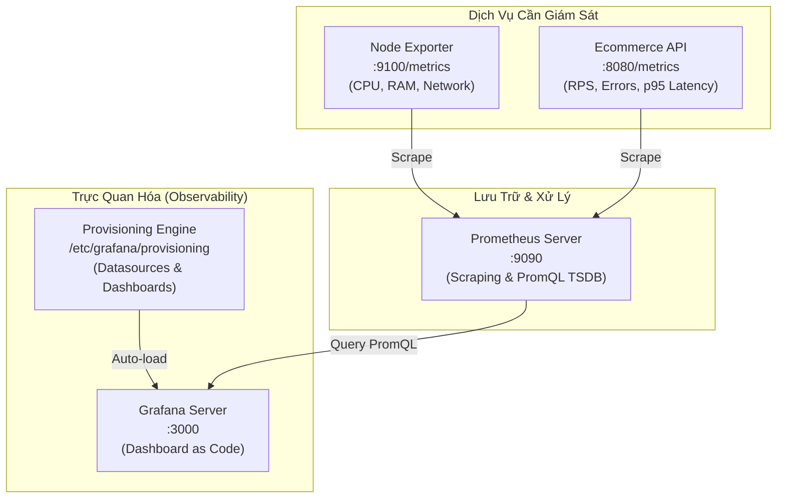

# Lab 42: Xây Dựng Monitoring Dashboard Với Grafana

Chào mừng bạn đến với bài thực hành **Xây Dựng Monitoring Dashboard Với Grafana**!

Trong các bài lab trước, bạn đã thu thập dữ liệu bằng Exporter (Lab 40) và làm chủ ngôn ngữ truy vấn PromQL để bóc tách các chỉ số hiệu năng (Lab 41). Tuy nhiên, trong môi trường sản xuất thực tế, các kỹ sư vận hành và ban quản trị không thể liên tục mở terminal hay chạy các câu lệnh curl thủ công để kiểm tra hệ thống. Bạn cần một **Dashboard tập trung, trực quan, cập nhật thời gian thực** — đó chính là sứ mệnh của **Grafana**.

---

### Kiến Trúc Hệ Thống Trong Bài Lab

---

### Tư Duy DevOps: Từ "ClickOps" Đến "Dashboard as Code"

Khi mới làm quen với Grafana, nhiều kỹ sư thường bấm chuột (ClickOps) trên giao diện Web UI để thêm DataSource và kéo thả Panel. Cách làm này có nhiều rủi ro:
- **Dễ mất dữ liệu:** Khi container Grafana bị xóa hoặc tái tạo trên máy chủ khác, toàn bộ dashboard biến mất nếu không gắn volume lưu trữ database SQLite.
- **Không có Version Control:** Không thể theo dõi ai đã sửa biểu đồ, không thể review code qua Pull Request hay rollback khi dashboard bị hỏng.
- **Khó nhân bản môi trường:** Không thể tự động triển khai đồng bộ cùng một bộ Dashboard lên hàng chục cụm Kubernetes hoặc các môi trường Dev/Staging/Production.

Trong bài lab này, bạn sẽ tiếp cận chuẩn thực hành cao cấp: **Grafana Provisioning (Dashboard as Code)**:
1. **Datasource Provisioning:** Khai báo nguồn dữ liệu Prometheus bằng tệp YAML. Grafana tự động kết nối ngay khi vừa bật nguồn.
2. **Dashboard Provisioning & Panels:** Định nghĩa các biểu đồ trực quan (Stat, Gauge, Time-Series) dưới dạng JSON schema chuẩn hóa.
3. **Mô hình RED & Phân tích hạ tầng:** Trực quan hóa CPU/RAM và phân tích SLA/SLO (Rate, Errors, Duration p95).
4. **Dynamic Templating (Variables):** Sử dụng các biến truy vấn động để tạo bộ lọc linh hoạt cho người dùng.

Nhấn **Start** để bước vào quy trình xây dựng Monitoring Dashboard chuẩn Production!
