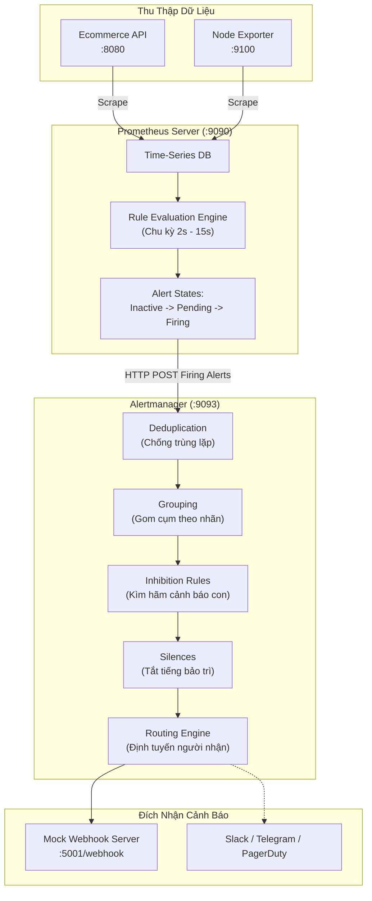

# Lab 43: Thiết Lập Cảnh Báo (Alerting)

Chào mừng bạn đến với bài thực hành **Thiết Lập Cảnh Báo (Alerting)** trong hệ thống giám sát Prometheus!

Trong văn hóa vận hành DevOps và kỹ nghệ độ tin cậy hệ thống (SRE - Site Reliability Engineering), Dashboard giúp bạn quan sát trực quan, nhưng **Alerting mới là tuyến phòng thủ chủ động** đánh thức kỹ sư trực ca (On-Call Engineer) giữa đêm khi các chỉ số chạm ngưỡng nguy hiểm, giúp khắc phục sự cố trước khi người dùng kịp phàn nàn.

---

### Kiến Trúc Phân Tách Giữa Prometheus Và Alertmanager

Một trong những thiết kế kiến trúc thông minh nhất của Prometheus là **tách biệt hoàn toàn việc tính toán cảnh báo khỏi việc gửi thông báo**:

---

### Hiểm Họa SRE: "Bão Cảnh Báo" (Alert Fatigue)

Một hệ thống giám sát tồi tệ là hệ thống bắn hàng nghìn tin nhắn mỗi ngày. Hậu quả là kỹ sư trực ca bị kiệt sức (Burnout), tắt chuông thông báo và cuối cùng bỏ lỡ sự cố nghiêm trọng (P1 Incident) thực sự.

Để xây dựng hệ thống cảnh báo chuẩn mực, bạn cần nắm vững 4 kỹ thuật cốt lõi trong bài lab này:
1. **Khoảng chờ trễ (`for` duration):** Tránh các cảnh báo chập chờn (Flapping Alert) khi CPU nhảy đột biến trong 1-2 giây rồi hạ nhiệt. Alert phải duy trì vượt ngưỡng liên tục trong trạng thái `Pending` trước khi chính thức chuyển sang `Firing`.
2. **Alertmanager Grouping:** Thay vì gửi 50 tin nhắn rời rạc khi 50 container sập cùng lúc, Alertmanager gom chúng thành duy nhất **1 thông báo tổng hợp**.
3. **Inhibition Rules:** Nếu toàn bộ máy chủ vật lý đã sập (`InstanceDown`), hãy tự động kìm hãm (mute) các cảnh báo thứ cấp như `HighCpuUsage` hay `ApiErrorRate` để tránh làm nhiễu loạn thông tin.
4. **Silencing & Maintenance Windows:** Tắt tiếng có thời hạn khi tiến hành triển khai nâng cấp (Deployment) có kế hoạch mà không cần xóa quy tắc cảnh báo.

Nhấn **Start** để bước vào quy trình thiết kế và thực chiến hệ thống cảnh báo tự động!
