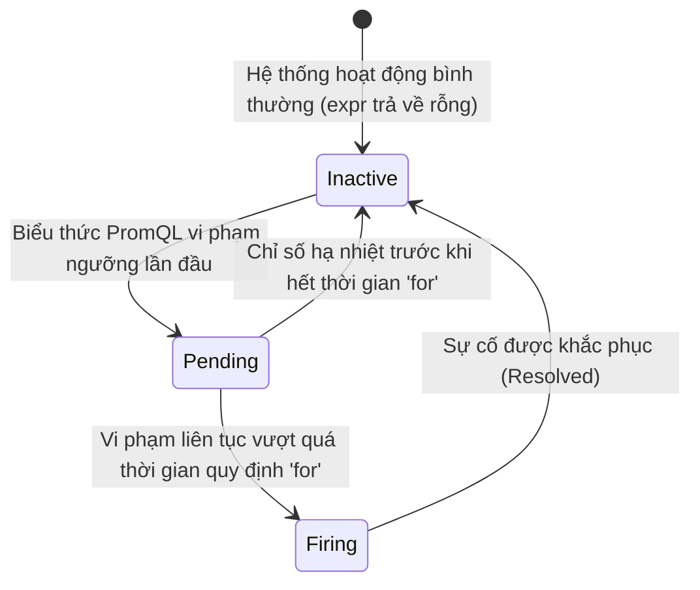

# Bước 1: Thiết Kế Alerting Rules Cho Hạ Tầng & Ứng Dụng

Trong Prometheus, **Alerting Rule** được định nghĩa bằng các tệp YAML chứa biểu thức PromQL. Prometheus Server sẽ định kỳ đánh giá (evaluate) các biểu thức này theo chu kỳ `evaluation_interval`.

---

### 1. Vòng Đời 3 Trạng Thái Của Cảnh Báo (Alert Lifecycle)

Mỗi quy tắc cảnh báo luôn trải qua một cỗ máy trạng thái (State Machine):



- **`Inactive`:** Không có chuỗi time-series nào thỏa mãn điều kiện lỗi. Trạng thái bình thường.
- **`Pending`:** Biểu thức vi phạm đã xuất hiện, nhưng Prometheus đang đếm giờ để xác thực sự cố kéo dài đủ lâu (`for: 30s`). Trạng thái này **chưa gửi thông báo** sang Alertmanager, giúp loại bỏ các đợt tăng tải đột ngột trong chớp mắt (Spikes).
- **`Firing`:** Lỗi đã kéo dài vượt quá thời gian `for`. Prometheus chính thức gửi cảnh báo sang Alertmanager để phát thông báo tới đội On-Call.

---

### 2. Thiết Kế Quy Tắc Cảnh Báo Cho Hạ Tầng (Host Alerts)

Tạo tệp quy tắc giám sát máy chủ Linux `/root/alerting-lab/rules/host_alerts.yml`:

```bash
cat << 'EOF' > /root/alerting-lab/rules/host_alerts.yml
groups:
  - name: host_infrastructure_rules
    rules:
      - alert: HostHighCpuLoad
        expr: (100 - (avg(rate(node_cpu_seconds_total{mode="idle"}[2m])) * 100)) > 80
        for: 30s
        labels:
          severity: warning
          tier: infrastructure
        annotations:
          summary: "May chu co muc su dung CPU vuot nguong 80%"
          description: "Muc su dung CPU hien tai dang la {{ $value | printf \"%.2f\" }}% tren instance {{ $labels.instance }}."
          runbook_url: "https://wiki.internal/runbooks/cpu-troubleshoot"

      - alert: HostOutOfMemory
        expr: (100 * (1 - (node_memory_MemAvailable_bytes / node_memory_MemTotal_bytes))) > 85
        for: 30s
        labels:
          severity: critical
          tier: infrastructure
        annotations:
          summary: "May chu sap can bo nho RAM kha dung (tren 85%)"
          description: "Bo nho RAM da su dung {{ $value | printf \"%.2f\" }}% tren {{ $labels.instance }}."
          runbook_url: "https://wiki.internal/runbooks/oom-investigation"

      - alert: ServiceTargetDown
        expr: up == 0
        for: 30s
        labels:
          severity: critical
          tier: platform
        annotations:
          summary: "Dich vu scrape bi gian doan (Target Down)"
          description: "Job {{ $labels.job }} tren {{ $labels.instance }} da ngung phan hoi."
          runbook_url: "https://wiki.internal/runbooks/target-down"
EOF
```

---

### 3. Thiết Kế Quy Tắc Cảnh Báo Cho Ứng Dụng (Application Alerts)

Tạo tệp quy tắc giám sát Web API `/root/alerting-lab/rules/app_alerts.yml`:

```bash
cat << 'EOF' > /root/alerting-lab/rules/app_alerts.yml
groups:
  - name: ecommerce_application_rules
    rules:
      - alert: ApiHighErrorRate
        expr: (sum(rate(http_requests_total{status=~"5.."}[1m])) / sum(rate(http_requests_total[1m]))) * 100 > 5
        for: 15s
        labels:
          severity: critical
          tier: backend
          service: ecommerce-api
        annotations:
          summary: "Ty le loi may chu 5xx vuot muc cho phep cua SLA (> 5%)"
          description: "Ty le loi 5xx dang la {{ $value | printf \"%.2f\" }}% tren dich vu ecommerce-api."
          runbook_url: "https://wiki.internal/runbooks/api-error-mitigation"
EOF
```

---

### 4. Kiểm Thử Cú Pháp Bằng `promtool` & Hot-reload Prometheus

Trong văn hóa DevOps, bạn không bao giờ nạp trực tiếp file YAML vào hệ thống đang chạy mà không kiểm tra cú pháp (Linting). Sử dụng công cụ chính thức **`promtool`** để kiểm thử:

```bash
# Kiểm tra cú pháp của 2 tệp rules
promtool check rules /root/alerting-lab/rules/host_alerts.yml
promtool check rules /root/alerting-lab/rules/app_alerts.yml
```

Nếu cả 2 lệnh đều trả về `SUCCESS`, tiến hành nạp cấu hình mới vào Prometheus bằng tính năng Hot-reload Zero-downtime:

```bash
curl -s -X POST http://localhost:9090/-/reload
```

Kiểm tra danh sách Alert Rules đang hoạt động qua Prometheus REST API:

```bash
curl -s http://localhost:9090/api/v1/rules | jq -r '.data.groups[].rules[] | {name: .name, state: .state, severity: .labels.severity}'
```

Bạn cũng có thể mở trình duyệt truy cập:
* `http://localhost:9090/alerts`: Xem 4 quy tắc cảnh báo ở trạng thái màu xanh lá (`INACTIVE`).
* `http://localhost:9090/rules`: Xem chi tiết biểu thức PromQL và các nhãn annotations đã cấu hình.

---

### 5. Yêu Cầu Hoàn Thành Bước 1

1. Tệp `/root/alerting-lab/rules/host_alerts.yml` và `/root/alerting-lab/rules/app_alerts.yml` được tạo và kiểm tra cú pháp hợp lệ qua `promtool`.
2. Prometheus API `/api/v1/rules` nạp đủ 4 alert rules: `HostHighCpuLoad`, `HostOutOfMemory`, `ServiceTargetDown`, `ApiHighErrorRate`.

Sau khi hoàn tất, nhấn **Check** để hệ thống tự động kiểm tra Bước 1.
