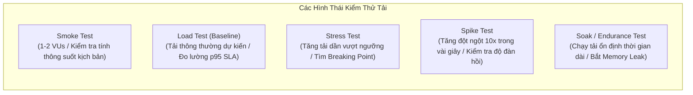

# Lab 44: Xây Dựng Kịch Bản Load & Stress Testing

Chào mừng bạn đến với bài thực hành **Xây Dựng Kịch Bản Load & Stress Testing** bằng công cụ chuẩn công nghiệp **k6**!

Trong kỹ nghệ độ tin cậy hệ thống (SRE) và triển khai hạ tầng DevOps, việc một ứng dụng chạy tốt trong môi trường nội bộ với vài ba request thủ công không có ý nghĩa gì khi bước ra môi trường Production. Khi một chiến dịch Marketing bùng nổ hoặc khung giờ cao điểm (Flash Sale) ập đến, hàng nghìn người dùng truy cập đồng thời có thể khiến hệ thống sập nguồn, tràn bộ nhớ hoặc nghẽn hàng đợi cơ sở dữ liệu.

Kỹ năng kiểm thử tải (Performance & Stress Testing) cho phép bạn chủ động khám phá giới hạn của hệ thống trước khi khách hàng gặp sự cố.

---

### Phân Biệt Các Loại Hình Kiểm Thử Hiệu Năng

| Loại hình kiểm thử | Mục đích chính | Tải thực thi | Thời gian chạy mẫu |
| :--- | :--- | :--- | :--- |
| **Smoke Test** | Kiểm tra kịch bản có chạy thành công không có lỗi cú pháp | 1 - 2 VUs | 5 - 30 giây |
| **Load Test (Baseline)** | Đo lường hiệu năng hệ thống ở mức tải người dùng thông thường | 10 - 30 VUs | 15 - 60 giây (lab) |
| **Stress Test** | Đẩy tải vượt mức thiết kế để tìm điểm gãy (Breaking Point) | 50 - 150+ VUs | Đa giai đoạn (Ramping) |
| **Spike Test** | Mô phỏng lưu lượng tăng vọt đột ngột và đánh giá tốc độ hồi phục | 0 -> 200 VUs tức thì | 1 - 2 phút |

---

### Tại Sao Chọn k6 Cho Quy Trình DevOps Hiện Đại?

Trước đây, các công cụ kiểm thử tải như Apache JMeter hay LoadRunner thường cồng kềnh, cấu hình qua giao diện đồ họa (GUI) phức tạp và tốn nhiều tài nguyên máy chủ.

**k6** (được phát triển bởi Grafana Labs) đã định hình lại chuẩn mực kiểm thử tải trong văn hóa DevOps với triết lý **Testing as Code**:
1. **Viết bằng JavaScript:** Lập trình viên và kỹ sư DevOps có thể viết kịch bản linh hoạt bằng JavaScript ES6 mà không cần học cú pháp độc quyền.
2. **Hiệu năng vượt trội:** Lõi của k6 được viết bằng ngôn ngữ Go, có thể tạo ra hàng chục nghìn Virtual Users (VUs) chỉ với một tiến trình duy nhất.
3. **Thresholds & CI/CD Gate:** Hỗ trợ định nghĩa các điều kiện đạt/hỏng (Pass/Fail) trực tiếp trong mã nguồn (ví dụ: `http_req_duration: ['p(95)<200']`), cho phép tự động ngắt pipeline CI/CD nếu bản build mới làm suy giảm hiệu năng.
4. **Tích hợp sâu sắc với Observability:** Xuất trực tiếp số liệu sang Prometheus, Grafana, InfluxDB hoặc Datadog.

---

### Kiến Trúc Môi Trường Thực Hành

Trong bài lab này, bạn sẽ tương tác với:
- **Target Application (Port 8080):** Ứng dụng mẫu giả lập dịch vụ thương mại điện tử với các API Endpoint:
  - `GET /health`: Kiểm tra trạng thái máy chủ.
  - `GET /api/products`: Danh mục sản phẩm (truy vấn nhanh).
  - `POST /api/orders`: Xử lý đơn hàng (tác vụ nặng, có cơ chế bão hòa thread pool khi tải vượt ngưỡng).
- **k6 CLI Engine:** Công cụ dòng lệnh thực thi kịch bản kiểm thử tải đặt tại `/root/load-test-lab`.

Nhấn **Start** để bước vào xây dựng kịch bản kiểm thử tải đầu tiên của bạn!
