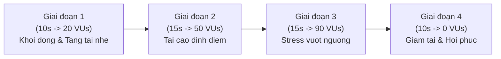

# Bước 3: Cấu Hình Kịch Bản Stress Test & Xác Định Điểm Gãy (Breaking Point)

Khác với Load Test (giữ tải cố định để đo hiệu năng thông thường), **Stress Test** là kỹ thuật tăng dần áp lực lên hệ thống vượt quá giới hạn thiết kế nhằm trả lời 2 câu hỏi sống còn:
1. **Điểm gãy (Breaking Point) nằm ở đâu?** (Hệ thống chịu được tối đa bao nhiêu người dùng đồng thời trước khi bắt đầu phản hồi chậm hoặc sinh lỗi 5xx).
2. **Hệ thống có khả năng tự phục hồi (Self-healing / Graceful Recovery) không?** (Khi lượng truy cập giảm xuống, hệ thống có trở lại trạng thái bình thường hay bị treo cứng và phải khởi động lại máy chủ).

---

### 1. Kỹ Thuật Tăng Tải Theo Giai Đoạn (Ramping Stages)

Để mô phỏng chân thực quy trình tải tăng dần, k6 cung cấp cấu hình `stages` thay cho `vus` cố định:



---

### 2. Tạo Kịch Bản Stress Test: `stress-test.js`

Tạo tệp kịch bản kiểm thử áp lực tác vụ đặt hàng (`POST /api/orders`) tại `/root/load-test-lab/scripts/stress-test.js`:

```bash
cat << 'EOF' > /root/load-test-lab/scripts/stress-test.js
import http from 'k6/http';
import { check, sleep } from 'k6';

export const options = {
  stages: [
    { duration: '10s', target: 20 },  // Ramp-up len 20 VUs
    { duration: '15s', target: 50 },  // Duy tri muc tai cao 50 VUs
    { duration: '15s', target: 90 },  // Ep tai vuot nguong len 90 VUs (Stress)
    { duration: '10s', target: 0 },   // Ramp-down ve 0 de kiem tra phuc hoi
  ],
};

export default function () {
  const url = 'http://localhost:8080/api/orders';
  const payload = JSON.stringify({
    item: 'Managed Redis Cluster',
    quantity: 2,
    timestamp: Date.now(),
  });

  const params = {
    headers: {
      'Content-Type': 'application/json',
    },
  };

  const res = http.post(url, payload, params);

  // Kiem tra ca ma trang thai va thoi gian phan hoi
  check(res, {
    'status is 201': (r) => r.status === 201,
    'response time < 350ms': (r) => r.timings.duration < 350,
  });

  sleep(0.05); // Think time 50ms giua cac lan goi API
}
EOF
```

---

### 3. Thực Thi Stress Test & Quan Sát Hiện Tượng Quá Tải

Chạy kịch bản Stress Test và xuất báo cáo ra `/root/load-test-lab/reports/stress-summary.json`:

```bash
k6 run --summary-export=/root/load-test-lab/reports/stress-summary.json /root/load-test-lab/scripts/stress-test.js
```

**Các hiện tượng diễn ra trong quá trình chạy:**
1. **Ở 0 - 25 giây đầu (20 - 50 VUs):** Hệ thống đáp ứng tốt, mã trả về toàn bộ là 201, độ trễ p95 duy trì dưới 100ms.
2. **Ở 25 - 40 giây (50 -> 90 VUs):** Khi số lượng VU vượt quá ngưỡng xử lý của thread pool (~70 VUs), **Điểm gãy (Breaking Point)** xuất hiện:
   - Thời gian phản hồi tăng vọt từ ~80ms lên trên 400ms - 800ms.
   - Bắt đầu xuất hiện các mã lỗi `503 Service Unavailable (Worker thread pool exhausted)`.
   - Tỷ lệ pass của check `'response time < 350ms'` bị sụt giảm.
3. **Ở 40 - 50 giây (Ramp-down về 0 VUs):** Khi lượng VU giảm dần, hàng đợi được giải phóng, ứng dụng khôi phục lại khả năng phản hồi bình thường mà không bị crash.

---

### 4. Đọc Chỉ Số Tỷ Lệ Lỗi Khi Quá Tải

Kiểm tra tỷ lệ lỗi và độ trễ phân vị p95 khi bị ép tải:

```bash
cat /root/load-test-lab/reports/stress-summary.json | jq '{
  total_requests: .metrics.http_reqs.values.count,
  failed_requests: .metrics.http_req_failed.values.passes,
  failure_rate_percent: ((.metrics.http_req_failed.values.rate * 10000 | round) / 100),
  latency_p95_ms: .metrics.http_req_duration.values["p(95)"],
  latency_max_ms: .metrics.http_req_duration.values.max
}'
```

*Kết luận rút ra cho SRE:* Điểm chịu tải an toàn của dịch vụ đơn hàng là dưới 50 người dùng đồng thời (~120 RPS). Vượt quá ngưỡng này, cần cấu hình Horizontal Pod Autoscaler (HPA) hoặc tối ưu kích thước connection pool.

Sau khi đã thực thi xong Stress Test và có tệp `stress-summary.json`, nhấn **Check** để hoàn thành Bước 3!
