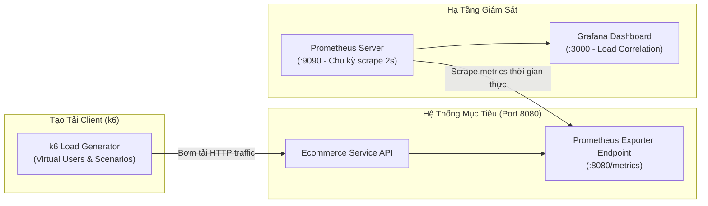

# Lab 45: Correlate Load Test Với Monitoring

Chào mừng bạn đến với bài thực hành đỉnh cao trong phân tích hiệu năng hệ thống: **Correlate Load Test Với Monitoring (Phân Tích Tương Quan Giữa Tải Và Hạ Tầng)**!

Trong thực tế, khi một kỹ sư chạy công cụ kiểm thử tải (như k6) và nhận về kết quả: *"Hệ thống bị chậm ở mức 100 VUs với p95 latency = 850ms và 15% lỗi 503"*, câu hỏi tiếp theo của ban lãnh đạo và đội ngũ kiến trúc sư luôn là:
> **"Tại sao lại chậm? Nút thắt cổ chai (Bottleneck) nằm ở CPU, RAM, Network I/O, hay do Database Connection Pool bị cạn kiệt?"**

Nếu chỉ nhìn báo cáo của k6 (Client-side metrics), bạn hoàn toàn mù tịt về nguyên nhân gốc rễ. Để trả lời chính xác, bạn bắt buộc phải **kết nối đồng bộ (Correlate)** giữa số liệu kiểm thử tải và số liệu đo đạc tài nguyên máy chủ (Server-side metrics) trên hệ thống Prometheus và Grafana.

---

### Kiến Trúc Phân Tích Tương Quan Thời Gian Thực

---

### Mô Hình USE & RED Trong Phân Tích Tải

Khi kết hợp Load Testing với Monitoring, chúng ta áp dụng đồng thời hai mô hình kinh điển của kỹ nghệ SRE:

1. **Mô hình RED (Tập trung vào Dịch vụ / Request):**
   - **Rate:** Tốc độ request mỗi giây (Throughput RPS) mà ứng dụng đang tiếp nhận.
   - **Errors:** Tỷ lệ lỗi 5xx xuất hiện khi ứng dụng bắt đầu quá tải.
   - **Duration:** Thời gian phản hồi (Latency) phân vị p95/p99 từ phía server.

2. **Mô hình USE (Tập trung vào Tài nguyên / Hạ tầng):**
   - **Utilization:** Mức độ sử dụng CPU/RAM (ví dụ: CPU đạt 90% công suất).
   - **Saturation:** Độ bão hòa và hàng đợi chờ (ví dụ: Active Connections chạm trần, Thread Pool bị nghẽn).
   - **Errors:** Các sự kiện lỗi phần cứng hoặc lỗi cấp phát bộ nhớ.

---

### Mục Tiêu Cần Đạt Được Trong Bài Lab

1. Nắm bắt toàn bộ kiến trúc thu thập dữ liệu thời gian thực giữa ứng dụng mục tiêu, Prometheus và Grafana.
2. Vừa chạy k6 sinh tải nền, vừa theo dõi trực quan các đồ thị biến thiên đồng bộ trên Grafana Dashboard.
3. Kích hoạt hiện tượng quá tải và thực hành đối chiếu số liệu (Correlation): nhận biết dấu hiệu CPU bão hòa kéo theo độ trễ tăng vọt và phát sinh lỗi 503.
4. Lập báo cáo Capacity Planning, xác định ngưỡng chịu tải an toàn và đề xuất giải pháp tối ưu hóa kiến trúc.

Nhấn **Start** để bước vào quy trình phân tích tương quan hiệu năng!
